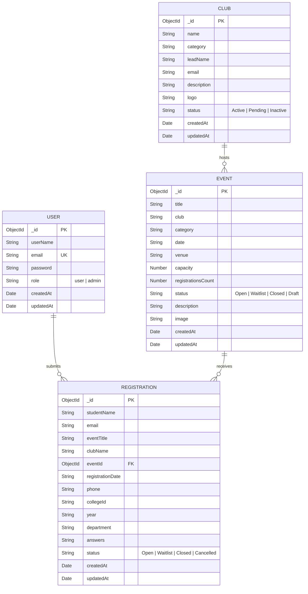

# 🌌 ClubSpace — Campus Club & Event Discovery Platform

ClubSpace is a next-generation, full-stack campus management and discovery web application designed for universities and student communities. It streamlines event organization, club exploration through an interactive **3D Cosmos Globe**, applicant registration management, and administrative workflows with real-time tracking and role-based permissions.

---

## 📌 Table of Contents
- [Project Overview](#-project-overview)
- [Tech Stack](#-tech-stack)
- [Key Features Implemented](#-key-features-implemented)
  - [Student & User Experience](#1-student--user-experience)
  - [Admin Command Center](#2-admin-command-center)
  - [Authentication & Security](#3-authentication--security)
- [Database & Schema Architecture](#-database--schema-architecture)
- [Project Directory Structure](#-project-directory-structure)
- [Setup & Installation Instructions](#-setup--installation-instructions)
  - [Prerequisites](#prerequisites)
  - [Backend Setup](#backend-setup)
  - [Frontend Setup](#frontend-setup)
  - [Running the Application](#running-the-application)
- [Test Accounts & Credentials](#-test-accounts--credentials)
- [External Templates & References Used](#-external-templates--references-used)
- [Screenshots & UI Showcase](#-screenshots--ui-showcase)

---

## 🚀 Project Overview

Universities host dozens of student clubs and hundreds of events each semester, but communication is often fragmented across messaging channels, social media, and static bulletin boards. 

**ClubSpace** unifies campus engagement into a single cosmic-themed portal:
- **For Students:** Explore registered clubs in an interactive **3D WebGL Cosmos Globe**, browse upcoming hackathons, workshops, and cultural fests, register in one click with custom questionnaires, and track RSVP statuses in a dedicated profile drawer.
- **For Administrators & Club Leads:** Publish and modify events, register clubs, monitor live capacity vs. registrations, manage registration statuses (`Open`, `Waitlist`, `Closed`, `Cancelled`), and export attendee rosters as CSV files.

---

## 🛠️ Tech Stack

### **Frontend**
- **Core Framework:** React 19, Vite 8
- **Styling & UI:** Tailwind CSS v4, Glassmorphic Design System, Custom Space Theme
- **3D Graphics & Canvas:** Three.js, `@react-three/fiber`, `@react-three/drei` (Fibonacci Sphere Distribution, Dynamic Node Projection, Occlusion Culling)
- **State Management:** Redux Toolkit (`@reduxjs/toolkit`), React-Redux
- **Routing:** React Router v7 (`react-router-dom`)
- **Animation & Transitions:** Framer Motion, GSAP, `tw-animate-css`
- **Iconography:** Lucide React (`lucide-react`)
- **HTTP Client:** Axios (with credentials and JWT handling)

### **Backend**
- **Runtime & Framework:** Node.js, Express.js (v5)
- **Database:** MongoDB with Mongoose ODM
- **Authentication & Security:** JSON Web Tokens (JWT), HTTP-Only Cookies, bcryptjs password hashing (12 salt rounds), CORS configured with credentials
- **Media & File Handling:** Cloudinary SDK, Multer
- **Environment Management:** `dotenv`

---

## ✨ Key Features Implemented

### 1. Student & User Experience (`/user/home`)
- 🌐 **Interactive 3D Club Cosmos Globe:**
  - Real-time 3D rendered sphere mapping all active university clubs onto 3D coordinates using a Fibonacci spiral algorithm.
  - Camera occlusion culling (dynamically fades back-facing labels to prevent clutter).
  - Click-to-inspect interactive nodes with neon glow and soundless hover dynamics.
- 🔍 **Live Search & Multi-Filter Engine:**
  - Filter events by category (Tech, Coding, Arts & Design, Sports, Academic, General) and timeframe (All, This Week, This Weekend).
  - Search clubs and events with instant reactive querying.
- 📝 **Event Registration Pipeline:**
  - Interactive RSVP modal collecting student credentials (Full Name, College ID, Department, Year of Study, Phone Number, and custom questionnaire answers).
  - Automatic registration counter incrementing against maximum venue capacity.
- 👤 **Student Profile & RSVP History Drawer:**
  - View logged-in credentials and role.
  - Track all registered events with live status badges (`Open`, `Waitlist`, `Closed`, `Cancelled`).
- 💡 **Propose Club / Event Access:**
  - Integrated drawers allowing students to propose new clubs and submit event drafts directly to administrators.
- 📜 **Dynamic Header & Scroll Progress:**
  - Animated navbar with section spy highlighting active viewport areas (`Home`, `Cosmos Globe`, `Clubs`, `Events`).
  - Spring-animated top reading/scroll progress indicator.

---

### 2. Admin Command Center (`/admin/dashboard`)
- 📊 **Metric Analytics Cards:**
  - Real-time summary counts: Total Clubs Registered, Total Events Published, Total Registrations Received, and Active Club Percentage.
- 📅 **Event Lifecycle Management:**
  - Create new events with venue, date, time, category, cover image, and capacity limits.
  - Hosting club validation: validates that the hosting club is registered on the platform before publishing.
  - Edit existing event parameters or delete expired events.
- 🏛️ **Club Registry:**
  - Add new campus clubs with lead coordinator details, contact emails, category tags, and club avatars/logos.
- 📋 **Attendee & Registration Hub:**
  - View all student submissions across all campus events.
  - Real-time status toggle (`Open`, `Waitlist`, `Closed`, `Cancelled`).
  - Filter applicant records by event, club, or student search query.
- 📥 **One-Click CSV Export:**
  - Export complete registration rosters into `.csv` format for spreadsheets and offline attendance tracking.

---

### 3. Authentication & Security
- 🛡️ **JWT-Based Authentication:**
  - Signed tokens transmitted via `httpOnly` secure cookies with fallback Authorization header support.
- 🔒 **Password Encryption:**
  - Passwords securely hashed with `bcryptjs` using 12 salt rounds before database persistence.
- 🚦 **Route Guards & Role Protection (`CheckAuth`):**
  - Authenticated route guards prevent unauthorized URL access.
  - Automatically redirects standard users away from `/admin/*` routes to `/user/home` or `/unauth-page`.
  - Non-authenticated visitors are automatically routed to `/auth/login`.

---

## 🗄️ Database & Schema Architecture

The MongoDB database consists of 4 primary schemas:



---

## 📂 Project Directory Structure

```text
Task1_ClubSpace/
├── backend/
│   ├── controllers/
│   │   ├── admin/
│   │   │   └── admin-controller.js     # Event CRUD, Club registration, CSV & attendee handling
│   │   ├── auth/
│   │   │   └── auth-controller.js      # User registration, login, logout, checkAuth middleware
│   │   └── user/
│   │       └── user-controller.js      # Public feeds, event RSVP, user registration history
│   ├── models/
│   │   ├── Club.js                     # Club schema definition
│   │   ├── Event.js                    # Event schema definition
│   │   ├── Registration.js             # Event registration schema definition
│   │   └── User.js                     # User authentication & role schema
│   ├── routes/
│   │   ├── admin/admin-routes.js       # Protected admin API routes
│   │   ├── auth/auth-routes.js         # Authentication endpoints
│   │   └── user/user-routes.js         # Public user API routes
│   ├── .env                            # Backend environment variables
│   ├── package.json
│   └── server.js                       # Express server initialization & MongoDB connection
│
├── frontend/
│   ├── public/
│   ├── src/
│   │   ├── assets/                     # Static assets & icons
│   │   ├── components/
│   │   │   ├── admin/
│   │   │   │   ├── AddClubDrawer.jsx   # Drawer for creating/registering clubs
│   │   │   │   └── AddEventDrawer.jsx  # Drawer for creating & editing events
│   │   │   ├── auth/
│   │   │   │   ├── AuthLayout.jsx      # Split-screen auth layout
│   │   │   │   └── SpaceBackground.jsx # Canvas stars & particle background
│   │   │   ├── common/
│   │   │   │   ├── check-auth.jsx      # Role-based route guard
│   │   │   │   └── ThreeSpaceBackground.jsx # Three.js dynamic stars backdrop
│   │   │   └── user/
│   │   │       ├── ClubDetailsModal.jsx    # Club overview modal
│   │   │       ├── ClubGlobe.jsx           # 3D interactive R3F cosmos globe
│   │   │       ├── RegistrationModal.jsx   # Event RSVP form modal
│   │   │       └── UserProfileDrawer.jsx   # Profile & registration history drawer
│   │   ├── pages/
│   │   │   ├── admin/AdminDashboard.jsx    # Full admin management console
│   │   │   ├── auth/Login.jsx              # Login page
│   │   │   ├── auth/Register.jsx           # Sign up page
│   │   │   ├── unauth/UnauthPage.jsx       # 403 unauthorized page
│   │   │   └── user/UserHome.jsx           # Student portal & club explorer
│   │   ├── store/
│   │   │   ├── admin-slice/                # Redux state for admin actions
│   │   │   ├── auth-slice/                 # Redux state for authentication & user session
│   │   │   ├── user-slice/                 # Redux state for public feeds & registrations
│   │   │   └── store.js                    # Redux store configuration
│   │   ├── App.jsx                         # Main router & app initialization
│   │   ├── index.css                       # Global styles, Tailwind & fonts
│   │   └── main.jsx                        # React root entrypoint
│   ├── .env                                # Frontend environment variables
│   ├── package.json
│   └── vite.config.js                      # Vite configuration
│
└── README.md                               # Project documentation
```

---

## 💻 Setup & Installation Instructions

### Prerequisites
- **Node.js**: v18.0.0 or later installed
- **npm**: v9.0.0 or later
- **MongoDB**: Active MongoDB Atlas connection string or local MongoDB instance

---

### Backend Setup

1. **Navigate to the backend directory:**
   ```bash
   cd backend
   ```

2. **Install backend dependencies:**
   ```bash
   npm install
   ```

3. **Configure Environment Variables (`backend/.env`):**
   Create or verify the `.env` file in `backend/` with the following variables:
   ```env
   PORT=5000
   MONGO_URI=your_mongodb_connection_uri_here
   JWT_SECRET=your_jwt_secret_key_here
   FRONTEND_URL=http://localhost:5173

   # Optional Cloudinary storage config (for image uploads)
   CLOUD_NAME=your_cloudinary_cloud_name
   API_KEY=your_cloudinary_api_key
   API_SECRET=your_cloudinary_api_secret
   ```

4. **Start the backend development server:**
   ```bash
   npm run dev
   # or
   npm start
   ```
   *The backend will be live at `http://localhost:5000` with MongoDB connected.*

---

### Frontend Setup

1. **Navigate to the frontend directory:**
   ```bash
   cd ../frontend
   ```

2. **Install frontend dependencies:**
   ```bash
   npm install
   ```

3. **Configure Frontend Environment Variables (`frontend/.env`):**
   Create or verify the `.env` file in `frontend/`:
   ```env
   VITE_API_URL=http://localhost:5000
   ```

4. **Start the Vite development server:**
   ```bash
   npm run dev
   ```
   *The frontend will run at `http://localhost:5173`.*

---

### Production Build

To create an optimized production build of the frontend:
```bash
cd frontend
npm run build
npm run preview
```

---

## 🔑 Test Accounts & Credentials

Use the following test credentials to log in and test different roles on the deployed or local platform:

| Role | Email | Password | Access Level |
| :--- | :--- | :--- | :--- |
| **Admin** | `admin@clubspace.edu` | `admin123` | Full access to Admin Dashboard, Event CRUD, Club Management, Attendee Hub & CSV Export |
| **Student / User** | `student@clubspace.edu` | `student123` | Access to Student Portal, 3D Cosmos Globe, Event Registration, RSVP History Drawer |

> 💡 **Note on New Signups:** Any new account created via the Register page (`/auth/register`) defaults to the `user` role. To promote an account to `admin`, update the `role` field from `"user"` to `"admin"` in the MongoDB `users` collection.

---

## 📚 External Templates & References Used

- **3D Graphics & Canvas:**
  - [Three.js](https://threejs.org/) & [React Three Fiber](https://r3f.docs.pmnd.rs/) for WebGL 3D rendering.
  - [@react-three/drei](https://github.com/pmndrs/drei) for OrbitControls, Stars, and 3D HTML projection.
- **UI & Layout Design:**
  - [Tailwind CSS v4](https://tailwindcss.com/) for modern utility-first CSS styling.
  - [Lucide Icons](https://lucide.dev/) for UI and category vector iconography.
  - [Geist Variable Fonts](https://vercel.com/font) for typography.
- **Animations:**
  - [Framer Motion](https://www.framer.com/motion/) for spring animations, modal reveals, and smooth page transitions.
  - [GSAP](https://greensock.com/gsap/) for micro-interactions and tweening.
- **State & Architecture:**
  - [Redux Toolkit (RTK)](https://redux-toolkit.js.org/) for centralized asynchronous state dispatch and slice reducers.
  - Express REST architecture with modular controller-route patterns.

---

## 📸 Screenshots & UI Showcase

| Screen | Description |
| :--- | :--- |
| 🌌 **3D Club Cosmos Globe** | Interactive 3D planetary visualization mapping student clubs onto spherical coordinates with dynamic hover cards. |
| 🎓 **Student Discovery Feed** | Categorized list of upcoming campus events with live search, tags, and direct registration triggers. |
| 📝 **Event RSVP Modal** | Multi-field registration modal collecting student data and custom questionnaire responses. |
| 🛠️ **Admin Dashboard** | Central command center with metric summaries, event creation/edit drawers, and club management. |
| 📋 **Registration Hub & CSV Export** | Full attendee roster with status toggle dropdowns and instant `.csv` export. |
| 🔐 **Cosmic Auth Portal** | Glassmorphic split-screen login and registration interface with particle starfield background. |
